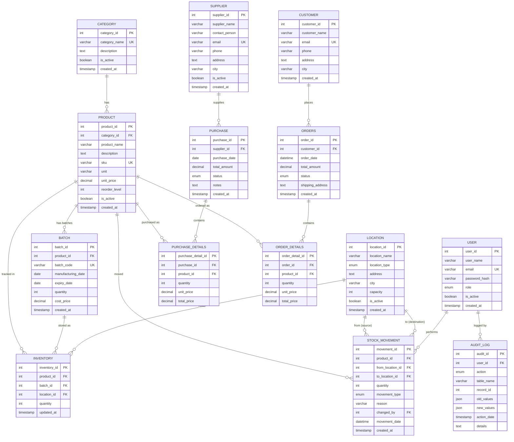

# Smart Inventory Management System — ER Diagram

## Entity-Relationship Diagram

## Relationship Summary

| Relationship | Type | Description |
|---|---|---|
| CATEGORY → PRODUCT | 1:M | Each category has many products |
| PRODUCT → BATCH | 1:M | Each product has many batches |
| PRODUCT → INVENTORY | 1:M | Each product appears in many inventory records |
| PRODUCT → PURCHASE_DETAILS | 1:M | Each product can be in many purchase line items |
| PRODUCT → ORDER_DETAILS | 1:M | Each product can be in many order line items |
| PRODUCT → STOCK_MOVEMENT | 1:M | Each product can have many movements |
| BATCH → INVENTORY | 1:M | Each batch is tracked across inventory locations |
| LOCATION → INVENTORY | 1:M | Each location holds many inventory records |
| LOCATION → STOCK_MOVEMENT (from) | 1:M | Each location is source of movements |
| LOCATION → STOCK_MOVEMENT (to) | 1:M | Each location is destination of movements |
| SUPPLIER → PURCHASE | 1:M | Each supplier has many purchases |
| PURCHASE → PURCHASE_DETAILS | 1:M | Each purchase has many line items |
| CUSTOMER → ORDERS | 1:M | Each customer places many orders |
| ORDERS → ORDER_DETAILS | 1:M | Each order has many line items |
| USER → STOCK_MOVEMENT | 1:M | Each user performs many movements |
| USER → AUDIT_LOG | 1:M | Each user's actions are logged |

> [!IMPORTANT]
> **LOCATION** is used as a single entity. `stock_movement` has two foreign keys into it:
> - `from_location_id` → `location.location_id` (source)
> - `to_location_id` → `location.location_id` (destination)

> [!NOTE]
> **PRODUCT** is the central entity in the schema, connected to 6 other tables.
